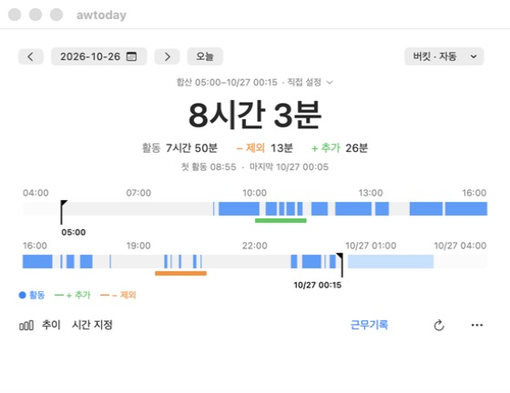

# awtoday

ActivityWatch의 AFK 기록을 바탕으로 하루 활동 시간을 확인하고 보정하는 macOS 앱입니다.
자동으로 기록된 활동에 추가·제외 시간을 반영하고, 날짜별 활동 흐름과 추이를 한눈에 볼 수 있습니다.

## 주요 기능

- **하루 활동 요약**: 날짜별 활동 시간과 추가·제외 시간을 반영한 합계를 보여줍니다.
- **활동 타임라인**: 하루의 활동 구간과 보정 내역을 시각적으로 확인할 수 있습니다.
- **시간 보정**: 기록에서 빠진 시간을 추가하거나 활동에서 제외할 구간을 관리할 수 있습니다. 선택한 하루 안의 미래 시간도 미리 저장할 수 있으며, 합계에는 현재까지 지난 구간만 반영합니다.
- **활동 합산 구간**: 기본값은 선택일 05:00부터 다음 날 00:00(자정)까지이며 날짜별로 변경할 수 있습니다. 타임라인은 ActivityWatch 기준 하루 전체를 유지하며, 서로 다른 끝 모양의 검정 막대와 검정 시각으로 합산 시작·끝을 표시합니다. 검정 막대를 누르면 강조되고, 드래그해 옮기면 합산 구간을 변경합니다.
- **활동 추이**: 최근 7일 또는 30일의 보정된 활동 시간을 비교할 수 있습니다.
- **기록 선택**: ActivityWatch의 AFK 버킷을 자동으로 선택하거나 직접 지정할 수 있습니다.
- **웹페이지 연결**: 자주 사용하는 웹페이지를 등록하고 기본 웹브라우저에서 열 수 있습니다.

설정과 보정 내역은 로컬에 저장하며, ActivityWatch 원본 기록은 변경하지 않습니다.

## 실행 환경

- macOS 13 이상, Apple Silicon
- 로컬에서 실행 중인 ActivityWatch 서버 (`http://localhost:5600`)
